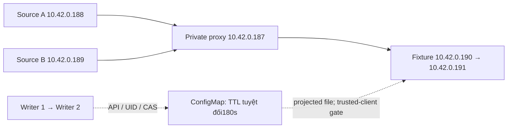

# ZER-46 — runtime09: component AC đạt kỹ thuật, sẵn sàng publication review

**COMPONENT_AC_OBSERVED_RAW_RECONCILED.** Một lượt đã được Hoàng duyệt kết thúc sau517,68giây; không retry. [Raw reconciliation](independent-verification.json) chạy offline với subprocess bị chặn, không dùng acceptance flag đơn lẻ làm PASS. [Review kết quả độc lập](independent-review.md) đã chấp nhận hai AC ở phạm vi component, không còn blocker và không cần thêm lượt lab. Chưa Done/merge/publication.

## Phạm vi và danh tính

HEAD9567830020954bf3f30fd5a74240747be0c8ec1c,source38file đóng băng, context k3d-zero-door/Docker desktop-linux. Bốn workload private trên k3d-zero-door-agent-0, namespace zd-sqli-lab/run owner zer46-b7cb40ec036e.0build/import/pull,29fixtureHTTP/29joins,7Boutique observerHTTP,4TCP controls,≤2RPS/concurrency1.

Source A/B có nhãn app=zer46-source; proxy app=zer46-private-ingress; fixture app=sqli-fixture. Tất cả mang zero-door.io/run=zer46-b7cb40ec036e. [Pod labels/IP](pods-latest.json), [rendered selectors/policy](bootstrap-static.yaml), [fixture/trusted proxy config](fixture.yaml). Enforcement ở trusted-client fixture, không dựa IP mặc định hoặc header tự khai của nguồn.

## AC → evidence

| Yêu cầu | Bằng chứng trong cùng lượt09 | Kết quả |
| --- | --- | --- |
| AC01: nguồn IP, NAT/header trust, selector/policy hook | source-addresses.json;29http/join pairs; log-pod-target; raw iptables hooks của hai fixture UID | Client A/B đúng IP gốc, tcp_peer đúngproxy, XFF_AFTER_TRUSTED/PROXY_CHAIN |
| Anti-spoof và isolation | http-007/join-007;4raw TCP controls trước/sau replacement | Header203.0.113.77 không đổi identity A; direct source→fixture9140 bị deny |
| AC02: block attacker/giữ benign trước restart | http/join009–015 | A403 SOURCE_BLOCKED cho GET/POST; B200/catalog và201/200/200/404 CRUD |
| Sau fixture restart | fixture-initial/fixture-after-replacement; http/join016–021 | UID vàIP đổi; A403/B200+CRUD có rawlog đúng Pod mới |
| Writer restart/replay bền vững | writer1exit,writer2hello/block; replay-readback | CM trước/sau bằng nhau, rule và expiry không đổi |
| TTL/expiry/unblock | original-rule;http/join022–027;component-observed | TTL180s gốc; sau expiry A/B200+CRUD, stored expired rule vẫn nguyên |
| Policy cleanup thực đo | policy-cleanup-api; raw mounted policy digest;http/join028–029 | Rules rỗng ở API+mount, A/B200 |
| Owned/shared/process cleanup | cleanup;UID delete options;raw namespace absence;before/after;writer1/2exit | Namespace UID absent, shared spec/UID/restart/3PVC nguyên,2actual writer EXITED/launcher0 |

Rule act_534429e95d8142bc9eacf1cc422367e7 cho client10.42.0.188, created1793176744/expires1793176924, gắn observed request7e856f80c68143748fbe6ce341d9f8c1. Sáu phase active hoàn tất khi còn57,398s tới expiry; không renew. Old fixture UIDd7f4cd47-ae74-4cf3-ac0c-8ff10eff5d49 thay bằng9ff0d676-9263-4663-8f20-c1bf7869bdc9; old Pod absence được kiểm riêng trong TTL idle.

Writer1 launcher19064/native17952; writer2 launcher18848/native10876. Mỗi actual process được pin logical/native executable, creation time, nonce và retained Windows handle. Hai native handle đều báo EXITED, launcher exit0; không suy từ PID launcher hoặc kill tiến trình lạ. FILETIME trong raw là integer64bit, không làm tròn qua JavaScript để ghi lại evidence.

## Guard và giới hạn kết luận

83mẫu guard không vi phạm, PSImax0,36; host available min3.365.990.400byte, WSLmin2.209.580KiB. failure.json không tồn tại; cleanup errors/guard_failures đều rỗng. Namespace UIDcede07df-cf17-4eb4-a3df-528efc96ad1b delete-precondition+absent.

**Component resource cleanup CLEAN.** Console originalaggregate vẫn INCOMPLETE vì Boutique business không đạt; cleanup.json giữ CLEAN_OWNED_RESOURCES_ONLY/lab_readiness NOT_MET_BOUTIQUE_NOT_HEALTHY. Không ghi toàn lab khỏe, KPI/R1/end-to-end hoặc LLM PASS. Không cộng lượt07/08/diagnostic vào lượt09; AC hiện tại dựa đúng raw09. Chrome/Claude historical causality vẫn chưa chứng minh; guard hiện tại đã đạt, không hạ ngưỡng.

Tất cả actor của lượt đã kết thúc; không còn quyền retry/attempt10. Code review đã có trước chạy; review raw đã hoàn tất, preservation/manifest được chốt cho gói publication. Commit/push/merge/Hoàng acceptance/Done là bước riêng chưa được thực hiện.
